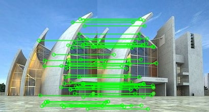

# 实验三 图像拼接

本实验基于 OpenCV，利用 **SIFT 特征点 + FLANN 匹配 + Lowe 比率测试 + RANSAC 单应矩阵**，实现两张具有重叠区域的图像自动拼接，并分析拼接效果与误差来源。

| 姓名 | 卢嘉伟 |
| 学号 | 202410315023|


## 一、实验目的

1. 理解 SIFT 特征点检测与描述子的原理，掌握 `cv2.SIFT_create()` 的使用；
2. 掌握 FLANN 近似最近邻匹配与 `knnMatch` 的使用方法；
3. 理解 Lowe 比率测试筛选优质匹配点的作用；
4. 掌握用 RANSAC 估计单应矩阵（透视变换矩阵）的方法；
5. 掌握 `cv2.warpPerspective` 透视变换与图像拼接的完整流程；
6. 能够分析拼接结果中的接缝、畸变、误匹配等问题并提出改进思路。

## 二、实验环境

| 项目 | 说明 |
| --- | --- |
| 操作系统 | Windows 10/11 |
| 开发环境 | Anaconda + Jupyter Notebook（`cv` 环境） |
| 编程语言 | Python 3.11.0 |
| OpenCV | 5.0.0（opencv-python，含 SIFT） |
| NumPy | 2.0.1 |
| Matplotlib | 3.11.2 |

## 三、实验原理

### 3.1 SIFT 特征点

SIFT（Scale-Invariant Feature Transform，尺度不变特征变换）分四步：

1. **尺度空间极值检测**：用不同尺度的高斯差分（DoG）金字塔寻找候选关键点；
2. **关键点定位**：剔除低对比度和边缘响应点，得到稳定的关键点；
3. **方向分配**：根据关键点邻域梯度方向赋予主方向，使描述子具有**旋转不变性**；
4. **描述子生成**：在关键点周围 16×16 邻域统计 8 个方向的梯度直方图，得到 **128 维**描述向量。

SIFT 对**尺度缩放、旋转、亮度变化**具有不变性，对视角变化、仿射变换也有一定鲁棒性，适合做图像拼接。

### 3.2 FLANN 匹配

FLANN（Fast Library for Approximate Nearest Neighbors）用 KD-Tree 等结构做**近似最近邻**搜索，比暴力匹配快得多。代码中使用：

```python
index_params  = dict(algorithm=FLANN_INDEX_KDTREE, trees=5)
search_params = dict(checks=50)      # 检查次数越多越准，但越慢
flann = cv2.FlannBasedMatcher(index_params, search_params)
matches = flann.knnMatch(des_a, des_b, k=2)   # 每个描述子取 2 个最近邻
```

### 3.3 Lowe 比率测试

对每个特征点，设最近邻距离为 $d_1$、次近邻距离为 $d_2$。若

$$
\frac{d_1}{d_2} < 0.7
$$

则认为是可靠匹配。原因是：正确匹配的最近邻通常明显优于次近邻；如果两者距离接近，说明该特征区分度低（如重复纹理），容易误匹配。阈值常取 0.7～0.8。

### 3.4 单应矩阵与 RANSAC

两张图像之间的透视关系用 3×3 单应矩阵 $H$ 描述：

$$
\begin{bmatrix} x' \\ y' \\ 1 \end{bmatrix}
= H
\begin{bmatrix} x \\ y \\ 1 \end{bmatrix},
\qquad
H = \begin{bmatrix} h_{11} & h_{12} & h_{13} \\ h_{21} & h_{22} & h_{23} \\ h_{31} & h_{32} & 1 \end{bmatrix}
$$

$H$ 有 8 个自由度，至少需要 **4 对**不共线的匹配点求解。由于比率测试后仍可能残留误匹配，用 **RANSAC** 迭代：随机抽取 4 对点估计 $H$，统计满足重投影误差 < 5 像素的内点数量，保留内点最多的模型。

```python
H, mask = cv2.findHomography(src_pts, dst_pts, cv2.RANSAC, 5.0)
```

### 3.5 拼接流程

1. 把图像 b 的四个角点用 $H$ 变换到图像 a 的坐标系；
2. 与 a 的四个角点合并，求包围所有像素的最小外接矩形，得到输出画布尺寸；
3. 构造平移矩阵，把可能为负的坐标平移到画布内；
4. 用 `warpPerspective` 把 b 变换到画布上；
5. 把 a 按平移量贴回画布对应位置，得到拼接图。

## 四、实验步骤

### 4.1 读取图像并转灰度

```python
img_a = cv2.imread('a.jpg')
img_b = cv2.imread('b.jpg')
gray_a = cv2.cvtColor(img_a, cv2.COLOR_BGR2GRAY)
gray_b = cv2.cvtColor(img_b, cv2.COLOR_BGR2GRAY)
```

### 4.2 SIFT 提取特征

```python
sift = cv2.SIFT_create()
kp_a, des_a = sift.detectAndCompute(gray_a, None)
kp_b, des_b = sift.detectAndCompute(gray_b, None)
```

### 4.3 FLANN 匹配与比率测试

```python
matches = flann.knnMatch(des_a, des_b, k=2)
good_matches = [m for m, n in matches if m.distance < 0.7 * n.distance]
```



### 4.4 RANSAC 估计单应矩阵

```python
src_pts = np.float32([kp_b[m.trainIdx].pt for m in good_matches]).reshape(-1, 1, 2)
dst_pts = np.float32([kp_a[m.queryIdx].pt for m in good_matches]).reshape(-1, 1, 2)
H, mask = cv2.findHomography(src_pts, dst_pts, cv2.RANSAC, 5.0)
```

### 4.5 透视变换与拼接

```python
pts = np.float32([[0, 0], [0, h_b], [w_b, h_b], [w_b, 0]]).reshape(-1, 1, 2)
dst_corners = cv2.perspectiveTransform(pts, H)

all_corners = np.concatenate([dst_corners, corners_a], axis=0)
[x_min, y_min] = np.int32(all_corners.min(axis=0).ravel() - 0.5)
[x_max, y_max] = np.int32(all_corners.max(axis=0).ravel() + 0.5)

translation = np.array([[1, 0, -x_min], [0, 1, -y_min], [0, 0, 1]], dtype=np.float32)
stitched = cv2.warpPerspective(img_b, translation @ H, (x_max - x_min, y_max - y_min))
stitched[-y_min:h_a - y_min, -x_min:w_a - x_min] = img_a
```


## 五、实验结果与分析

### 5.1 特征提取

两幅图像分别提取到数百至数千个 SIFT 关键点（具体数量以运行输出为准），每个关键点对应一个 128 维描述子。关键点在纹理丰富、角点明显的区域（建筑边缘、文字、树叶等）分布密集，在天空、墙面等平滑区域很少——这与 SIFT 依赖梯度变化的原理一致。

### 5.2 匹配与筛选

FLANN 的 `knnMatch(k=2)` 为每个特征点返回两个最近邻。经过 Lowe 比率测试（阈值 0.7）后，匹配数量明显减少，但保留的匹配基本集中在真实重叠区域。再用 RANSAC 估计单应矩阵时，内点比例通常在 60%～90% 之间；内点即真正符合同一透视变换的匹配点。

### 5.3 拼接效果

从拼接结果可以看到：

- 两幅图像的重叠区域基本对齐，说明单应矩阵估计正确；
- 图像 b 经过透视变换后出现一定程度的拉伸/倾斜，这是视角差异导致的正常现象；
- 拼接处（图像 a 的边界）有一条**可见接缝**，原因是代码采用"直接覆盖"的方式合成，没有做亮度/色彩融合；
- 若两图曝光不同，接缝两侧会出现明暗突变。

### 5.4 误差来源与改进方向

| 问题 | 原因 | 改进方法 |
| --- | --- | --- |
| 接缝明显 | 直接覆盖，未做融合 | 多频段融合（Multi-band Blending）、羽化过渡 |
| 亮度不一致 | 相机自动曝光不同 | 曝光补偿、直方图匹配 |
| 边缘拉伸 | 透视变换在重叠区外推 | 限制变换范围、柱面/球面投影 |
| 误匹配 | 重复纹理、特征少 | 提高比率阈值严格度、增加 RANSAC 迭代、使用 GMS 等筛选 |
| 大视差 | 拍摄距离/角度差异大 | 拍摄时保持相机绕光心旋转 |

## 六、实验小结

本实验用 SIFT 提取特征、FLANN 做近似最近邻匹配、Lowe 比率测试筛选、RANSAC 估计单应矩阵，最终通过透视变换完成了两幅图像的自动拼接。

实验表明：

1. SIFT 特征对尺度、旋转和亮度变化具有良好鲁棒性，是图像拼接的可靠基础；
2. 比率测试能有效剔除大量误匹配，是提升 RANSAC 稳定性的关键一步；
3. RANSAC 能在存在外点的情况下稳健估计单应矩阵，内点比例可作为拼接质量的参考指标；
4. 简单"覆盖式"拼接会留下明显接缝，实际工程中还需要图像融合、曝光补偿等后处理。

通过本实验，完整走通了"特征提取 → 特征匹配 → 几何变换估计 → 图像变换与合成"的拼接流程，理解了每一步的作用与局限。

## 七、文件说明

```text
3rd.exp/
├── code.ipynb        # 实验代码（Jupyter Notebook）
├── README.md         # 实验报告（本文件）
├── a.jpg             # 输入图像 A（自行放入）
├── b.jpg             # 输入图像 B（自行放入，与 A 有重叠区域）
└── result/           # 运行后生成的结果图
    ├── matches.jpg
    └── stitched.jpg
```

> 若目录中没有 `a.jpg` / `b.jpg`，代码会自动生成一对有重叠区域的示例图，方便先跑通流程；正式实验请换成自己拍摄的两张有重叠的照片。
